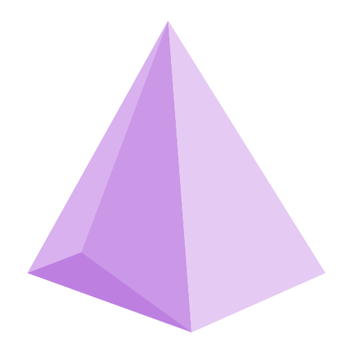
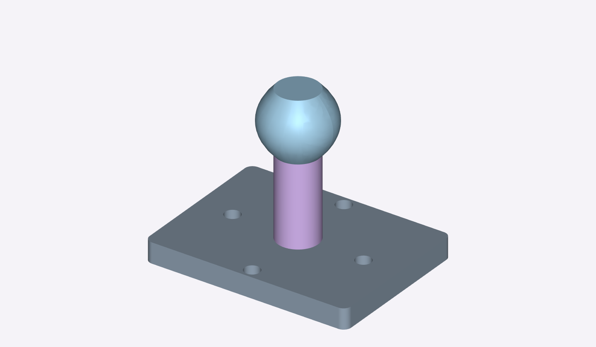
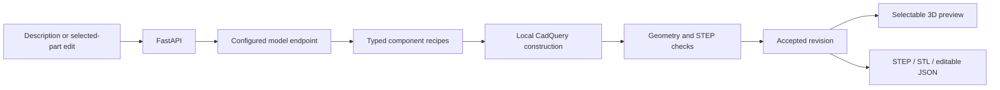

<div align="center">
  
  <h1>Prompt to CAD</h1>
  <p><strong>Turn an idea into editable 3D parts and assemblies.</strong></p>
  <p>A Windows desktop CAD prototype built with React, FastAPI and CadQuery.</p>
  <p>Selectable parts · Parametric history · STEP / STL export</p>
  <p><a href="#example-spindle-assembly">Example</a> · <a href="#quick-start">Quick start</a> · <a href="#how-it-works">Architecture</a> · <a href="#development">Development</a> · <a href="#privacy-and-local-data">Privacy</a></p>
</div>

---

## About

Describe a design in plain language, create its 3D model, then select a component and ask for a change. Prompt to CAD keeps named dimensions, construction features and relationships between parts so an accepted design can be rebuilt, edited and exported.

The application runs CAD operations locally on the CPU. Natural-language creation and editing use an OpenAI-compatible model endpoint that **you configure**. You can open the included example without an API key or model connection.

## Features

| Capability | What it provides |
| --- | --- |
| Prompt-driven modelling | Staged assembly planning, component construction and bounded repair using geometry feedback. |
| Editable geometry | Sketches, extrusions, revolutions, sweeps, lofts, cuts, holes, fillets, chamfers, patterns, mirrors and geometric threads. |
| Separate components | Select parts in the 3D view or parts tree, inspect parameters and apply scoped edits. |
| Parametric relationships | Rebuild dependent dimensions and placements, including attachments to parent bounding faces. |
| Saved projects | Local construction history, accepted revisions and undo/redo. |
| Verified exports | Solid, dimension and assembly checks, STEP export/re-import, STL and editable `.cad.json` files. |

## Example: spindle assembly



A three-part assembly demonstrates the workflow: an **80 x 60 x 8 mm mounting base** with four mounting holes, a **16 mm diameter spindle** and a **lofted grip**. Each component keeps its own parameters and construction history. The grip's position depends on the spindle height.

1. Launch the app and choose **Open → Open .cad.json file**.
2. Open [the spindle assembly](examples/spindle-assembly.cad.json).
3. Select **Spindle** in the viewport or parts tree.
4. With your model configured, ask: **“Make the selected spindle 48 mm tall. Keep its diameter unchanged and keep the grip connected on top.”**
5. Inspect how the grip follows the new height, try Undo/Redo, and export STEP or STL.

The image renders the supplied CAD geometry. Opening the file rebuilds the assembly without inference. Conversational edits require your own configured model; inspect the resulting dimensions and connections before using an export.

## Quick start

### Requirements

- Windows with the [Microsoft Edge WebView2 Runtime](https://developer.microsoft.com/en-us/microsoft-edge/webview2/).
- Python **3.11** with pip.
- Node.js **24** with npm.
- Your own OpenAI-compatible chat-completions endpoint for prompt creation and editing. This can be a hosted service or a local inference server.

### 1. Clone and install

Open PowerShell:

```powershell
git clone https://github.com/faheem-shah-umer/Prompt-to-CAD.git
Set-Location Prompt-to-CAD
py -3.11 -m venv .venv
.\.venv\Scripts\python.exe -m pip install -r backend\requirements-dev.txt
Copy-Item backend\.env.example backend\.env
Push-Location frontend
npm.cmd ci
Pop-Location
& '.\Setup desktop.cmd'
```

### 2. Configure your model

Edit `backend/.env` with your own settings. The repository supplies **no credentials, endpoint or default model**.

```dotenv
LLM_BASE_URL=https://your-provider.example/v1
LLM_MODEL=your-model-id
LLM_API_KEY=your-own-key
LLM_PROVIDER=custom
LLM_JSON_MODE=false
LLM_TIMEOUT_SECONDS=90
```

The app appends `/chat/completions` to `LLM_BASE_URL`. Your model must reliably follow structured instructions. Enable `LLM_JSON_MODE` only when your endpoint supports JSON-object response formatting.

For a local [Ollama server](https://docs.ollama.com/api/openai-compatibility), use `LLM_BASE_URL=http://localhost:11434/v1`, choose a model you have installed and leave `LLM_API_KEY` blank. Local inference hardware requirements depend on the model. Hosted providers may charge for requests; the application does not supply free access or switch providers automatically.

### 3. Launch

Double-click **`Prompt to CAD.vbs`**. The desktop window opens with its own local backend. Closing it stops that backend.

To create a design, enter its parts, dimensions and connections in **Explain Our Idea**, then choose **Create**. Review assumptions and inspect the accepted geometry before using an export. After changing model settings, restart the app.

If the desktop dependencies are missing, run **`Setup desktop.cmd`** again. Keep `.desktop-runtime/`; `tmp/` contains disposable launch diagnostics and browser profiles and can be removed while the application is closed.

## How it works



The model proposes structured operations; the backend runs its own modelling tools rather than executing model-generated Python. Rejected plans receive validation feedback within a fixed request budget. Failed generation and stale edits preserve the accepted revision.

| Layer | Technology |
| --- | --- |
| Desktop | pywebview, Microsoft WebView2 |
| Interface | React, TypeScript, Three.js, Vite |
| API and validation | FastAPI, Pydantic |
| Geometry | CadQuery, OpenCascade |
| Inference | User-configured OpenAI-compatible endpoint |
| Storage | Local JSON revisions and CAD exports |

Learn more in the [architecture guide](docs/architecture.md), [generation pipeline](docs/generation-pipeline.md) and [script guide](docs/script-guide.md).

## Development

From the project root, start the API:

```powershell
.\.venv\Scripts\python.exe -B -m uvicorn backend.app.main:app --reload --host 127.0.0.1 --port 8000
```

In a second terminal, run `npm.cmd run dev` from `frontend/`. Open the [development interface](http://127.0.0.1:5173) or [interactive API docs](http://127.0.0.1:8000/docs).

Run the checks from the project root:

```powershell
.\.venv\Scripts\python.exe -B -m unittest discover -s backend\tests -v
Push-Location frontend
npm.cmd run build
Pop-Location
```

Tests mock provider requests and construct real CAD geometry. After frontend changes, rebuild and reopen the desktop app.

```text
backend/               API, planning, geometry and tests
frontend/              Desktop interface and application icon
examples/              Editable CAD specifications and regression inputs
docs/                  Architecture, generation and script guides
desktop-app.py         Desktop window and local backend lifecycle
Prompt to CAD.vbs      Windows entry point
Setup desktop.cmd     Desktop runtime installation and interface build
```

## Privacy and local data

- Keep credentials in the ignored `backend/.env`; only the empty `.env.example` template belongs in Git.
- Saved projects, exports, generation journals, logs, browser profiles and installed dependencies are excluded from Git.
- Hosted inference sends your prompt and relevant design context to **your configured provider**. CAD construction runs locally; this does not make hosted inference private or offline.
- Generation diagnostics contain prompts and model responses. Review them before attaching them to a public issue.
- Commit only deliberate, shareable examples. Check staged files before publishing; ignore rules do not remove files from existing history.

## Current scope

This is an extensible CAD prototype. Supported operations and geometry validation do not guarantee that every description becomes a correct design. Full assembly constraint solving, face/edge selection and STEP import are future work. Geometry checks do not certify mechanical function, strength, manufacturability or standards compliance; threads are geometric demonstrations.

## Contributing and licence

Issues and focused pull requests are welcome. Include reproduction steps, run the backend tests and frontend build, and remove private prompts, credentials and local paths from reports.

Project source, documentation and original icon artwork are available under the [MIT licence](LICENSE). Dependencies and model services retain their own terms; see [third-party notices](THIRD_PARTY_NOTICES.md).
