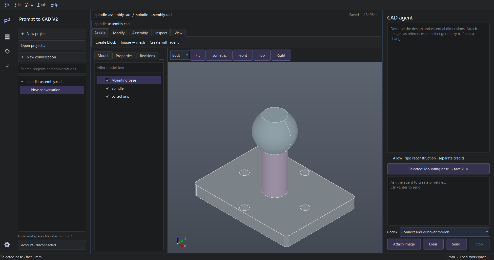

# Prompt to CAD V2

A Windows desktop CAD workspace with an integrated Codex agent for creating, inspecting and refining 3D designs.



V2 retains the existing CadQuery/OpenCascade modelling engine, verified solid exports and reversible revisions, and adds a C++/Qt workspace, persistent projects/conversations and a real Codex App Server integration. This remains a developing application; the implementation does not imply production readiness or support for every CAD format.

## Run

On the configured development machine, open **Prompt to CAD V2.vbs**, or run:

```powershell
.venv\Scripts\python.exe native-app.py
```

For a fresh environment, install [requirements-v2.txt](requirements-v2.txt), the matching native SDKs, and build with `tools/build_native.py --test`. See [V2 setup and usage](docs/v2-workspace.md) for complete instructions.

Connect your own eligible ChatGPT plan through **Account → Continue with ChatGPT**, then discover models. API-key billing is a separate explicit option. Tasks never silently switch billing paths. The app uses its own authorized OAuth registration and Windows-protected credentials.

## Current capabilities

- STEP/STP and editable recipe import; separate mesh imports for GLB/STL/OBJ/PLY.
- Native solid/mesh viewport, assembly manager, precise solid topology selection and explicit mesh regions.
- Streamed Codex conversations with task progress, cancellation, reference images and frozen selection context.
- Scoped candidate editing, restricted CAD scripts, validation and undoable accepted revisions.
- Persistent conversations sharing a document, revision restore and project reopening.
- STEP/STL solid exports and GLB/STL visual exports.

Live Codex acceptance tests verified selected-component thickening, unrelated-component preservation, undo/redo, reopening/session continuation, text creation and conversational hole creation. The Tripo image-generation integration is implemented with separate billing consent, but **paid live generation remains pending at the user's request**. Fixture tests and imported meshes are not presented as generated service results.

See [stage status](docs/V2_IMPLEMENTATION.md), [capabilities and limitations](docs/v2-workspace.md), [validation evidence](artifacts/v2-validation/), and [third-party notices](THIRD_PARTY_NOTICES.md). The earlier [web prototype](docs/earlier-prototype.md) and [native workspace reference](docs/native-workspace.md) remain available.
