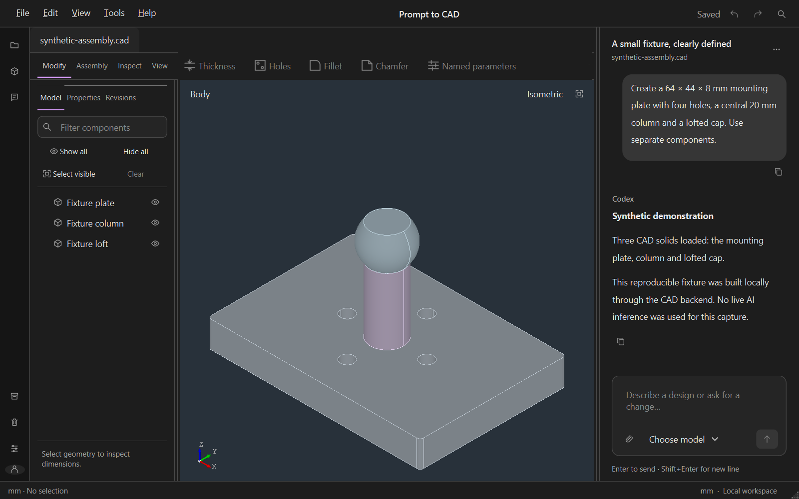

# Prompt to CAD

**A personal Windows CAD project for describing parts, inspecting geometry and refining designs through conversation.**

This is an early preview built with Qt, OpenCascade and a Python CAD backend. I maintain it for my own development. You can use or adapt the source under the [MIT license](LICENSE). There is no contributor program or prebuilt application distribution; set up your own environment and build the source.

[Source setup](docs/setup.md) · [Architecture](docs/architecture.md) · [Capabilities](docs/agentic-cad.md) · [Privacy](docs/privacy.md)



*Synthetic example: a 64 × 44 × 8 mm mounting plate with four holes, a central 20 mm column and a lofted cap. The local backend built the three solids; this is not recorded live AI inference. [Media provenance](site/assets/PROVENANCE.md).*

## Current capabilities

- Native solid/mesh viewing, component selection, measurement, visibility and placement.
- Supported holes, offsets, fillets, chamfers, parameters and controlled CadQuery scripts.
- Chat-controlled [standard parts](docs/standard-parts.md): cq_warehouse fasteners, bearings, sprockets, chains and threads with retained generator parameters.
- Local projects/conversations, accepted revisions, undo/redo and Save As.
- Component colors, dimensions, labels and notes; reference images depend on model support.
- STEP/STP and editable JSON recipe import; GLB, STL, OBJ and PLY mesh import.
- STEP/STL solid export and GLB/STL visual export.

Imported files do not gain invented feature history. Full sketch constraints, simulation, full GD&T and arbitrary proprietary CAD formats are not implemented. Geometric validity does not establish strength, tolerances or manufacturability.

## Build and run

Install **Git**, **CPython 3.11 x64** (including the `py` launcher), and **Visual Studio 2022 C++ Build Tools** with Desktop development with C++, x64/x86 v143 tools and a Windows SDK. Use Windows 10/11 x64 with an OpenGL-capable graphics driver. The setup below downloads pinned **Qt 6.9.0** and **OpenCascade 7.8.1** SDKs; Anaconda is not required. See [setup](docs/setup.md) for details and troubleshooting.

```powershell
git clone https://github.com/faheem-shah-umer/Prompt-to-CAD.git
cd Prompt-to-CAD
py -3.11 -m venv .venv
.venv\Scripts\python.exe -m pip install -r requirements-dev.txt
.venv\Scripts\python.exe -m tools.setup_windows --download-sdk
.venv\Scripts\python.exe -m tools.build_native
.\Run-PromptToCAD.cmd
```

The build produces `build\bin\PromptToCAD.exe`. After setup and a successful build, run `Run-PromptToCAD.cmd` again to start the application; it never installs dependencies or builds automatically. It also works from another directory or by double-clicking. Missing prerequisites or application files produce instructions for the next step. Rebuild explicitly after changing C++ source.

Viewing, import/export, measurement and supported direct tools work without AI. AI features need a separately installed Codex executable supporting App Server and your own eligible account or API key. No credentials or model weights are included.

## Local files and checks

Projects, conversations and account state are private local data; see [storage locations](docs/privacy.md). AI requests send submitted context to the configured provider.

Builds, SDK downloads and development tools stay in ignored folders **inside this repository**: `.venv/`, `build/`, `.sdk/`, `.local/`, `tmp/` and `artifacts/`. They do not belong in Git. The portable source launcher uses `build\bin\PromptToCAD.exe` without a private runtime or absolute-path shortcut. The existing personal VBS/desktop shortcut separately preserves `.local/desktop-build/` when present.

```powershell
.venv\Scripts\python.exe -m tools.check_privacy
.venv\Scripts\python.exe -m tools.check_links
.venv\Scripts\python.exe -m tools.validate
```

Run checks deliberately. They use synthetic data, not live provider inference. The manual **Windows source check** workflow installs dependencies, builds and tests on a fresh Windows x64 runner, including a native viewport smoke check through the portable launcher.

Application source and original branding/icons use MIT. Dependencies retain their own licenses; see [third-party notices](THIRD_PARTY_NOTICES.md). Keep personal projects, chats, credentials and development environments out of tracked source. Existing Git history needs privacy review before any future public visibility change.
