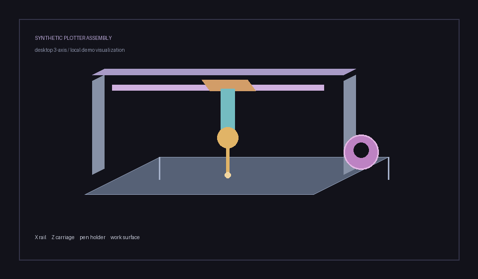

# Prompt to CAD

### A conversation with geometry.

Prompt to CAD is an open-source Windows workspace for describing parts, inspecting native geometry, and refining designs through conversation. Keep the model, component tree, measurements, revisions, and local project history in one place.

[Build from source](#build-from-source) · [See the workflow](#how-it-works) · [Read the capabilities](docs/agentic-cad.md) · [Visit the project site](site/)

<p align="center">
  <picture>
    <source srcset="site/assets/workspace-demo.gif" type="image/gif">
    
  </picture>
</p>

> **A synthetic visualization, not a screenshot.** The visual above is generated locally from a reproducible desktop 3-axis pen plotter assembly. It communicates the intended example without pretending to show live AI inference or a finished machine. See the [media provenance](site/assets/PROVENANCE.md).

## Why Prompt to CAD?

Most CAD conversations stop at text. Prompt to CAD keeps the conversation beside inspectable geometry:

- **Describe** a part, assembly, dimension, or revision in plain language.
- **Inspect** actual solids in a native viewport with selection, visibility, labels, and measurement.
- **Refine** supported geometry with direct tools or a controlled CAD script.
- **Keep** accepted revisions, undo/redo, projects, and conversations locally organized.

## The workflow

### 1. Start with intent

Describe the shape and the constraints that matter: dimensions, holes, offsets, fillets, chamfers, materials of reference, or how components relate.

### 2. Check the geometry

Orbit the native viewport, select components, measure features, toggle visibility, and inspect what the backend actually created. Imported files do not gain invented feature history.

### 3. Refine what you can verify

Accept a revision only after the candidate result passes the available checks. Continue the conversation, use supported direct tools, or save a new project revision.

## What is included

| Geometry | Projects | Exchange |
| --- | --- | --- |
| Holes, offsets, fillets, chamfers, parameters, and controlled CadQuery scripts | Local projects, conversations, accepted revisions, Save As, undo/redo, component colors, labels, and notes | STEP/STP and editable JSON recipe import; GLB, STL, OBJ, and PLY mesh import; STEP/STL solid export; GLB/STL visual export |

Chat-controlled [standard parts](docs/standard-parts.md) include cq_warehouse fasteners, bearings, sprockets, chains, and threads with retained generator parameters.

> **Engineering context matters.** Geometric validity is not a strength, tolerance, or manufacturability assessment. Full sketch constraints, simulation, full GD&T, and arbitrary proprietary CAD formats are not implemented.

## Build from source

Prompt to CAD currently documents a Windows 10/11 x64 source-build path. Install **Git**, **CPython 3.11 x64** with the `py` launcher, and **Visual Studio 2022 C++ Build Tools** with Desktop development with C++, x64/x86 v143 tools, and a Windows SDK.

The setup downloads pinned Qt 6.9.0 and OpenCascade 7.8.1 SDKs. Anaconda is not required.

```powershell
git clone https://github.com/faheem-shah-umer/Prompt-to-CAD.git
cd Prompt-to-CAD
py -3.11 -m venv .venv
.venv\Scripts\python.exe -m pip install -r requirements-dev.txt
.venv\Scripts\python.exe -m tools.setup_windows --download-sdk
.venv\Scripts\python.exe -m tools.build_native
.\Run-PromptToCAD.cmd
```

For version details, troubleshooting, and a clean-machine walkthrough, see [docs/setup.md](docs/setup.md). The build produces `build\bin\PromptToCAD.exe`; launching the command again does not install dependencies or build automatically.

Viewing, import/export, measurement, and supported direct tools work without AI. AI features require a separately installed Codex executable supporting App Server plus your own eligible account or API key. No credentials or model weights are included.

## Checks and local data

Run the repository checks deliberately:

```powershell
.venv\Scripts\python.exe -m tools.check_privacy
.venv\Scripts\python.exe -m tools.check_links
.venv\Scripts\python.exe -m tools.validate
```

Projects, conversations, account state, builds, SDK downloads, and development tools stay local. See [docs/privacy.md](docs/privacy.md) for storage locations and provider boundaries. AI requests send submitted context to the configured provider; offline CAD tools do not need an AI connection.

Ignored working folders include `.venv/`, `build/`, `.sdk/`, `.local/`, `tmp/`, and `artifacts/`. Keep personal projects, chats, credentials, and development environments out of tracked source.

## Project map

- [Capabilities and limits](docs/agentic-cad.md)
- [Architecture](docs/architecture.md)
- [Source setup](docs/setup.md)
- [Standard parts](docs/standard-parts.md)
- [Privacy boundaries](docs/privacy.md)
- [Static project site](site/)
- [Third-party notices](THIRD_PARTY_NOTICES.md)

## Status and license

This is a personally maintained project and an early, evolving preview. The application source and original branding are available under the [MIT license](LICENSE). Dependencies retain their own licenses; see [THIRD_PARTY_NOTICES.md](THIRD_PARTY_NOTICES.md).

There is no prebuilt application distribution or hosted CAD service in this repository. Build the source, inspect the behavior, and use your own judgment about every generated design.
