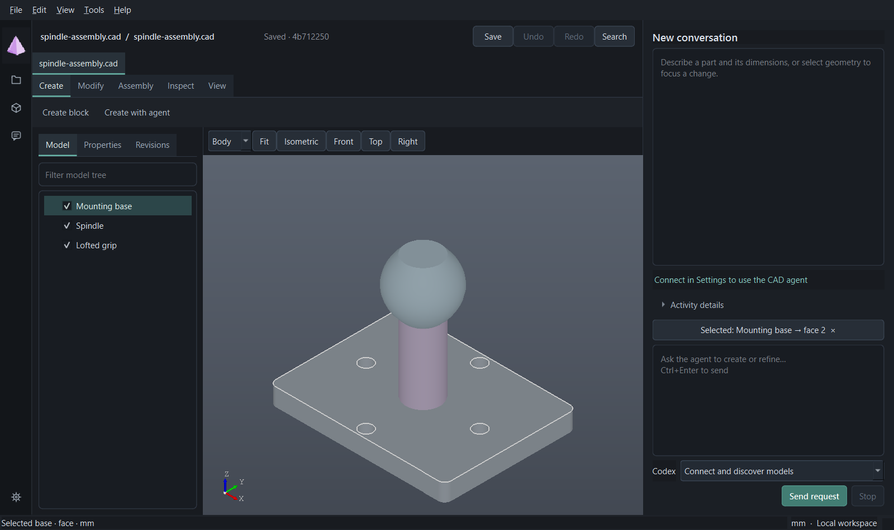

# Prompt to CAD V2

The current Windows desktop CAD workspace for text-driven creation and selected-part editing with Codex.

Open **Prompt to CAD V2.lnk** (created by the native build with our logo), **Prompt to CAD V2.vbs**, or run `.venv\Scripts\python.exe native-app.py`.

For a fresh checkout, install [requirements-dev.txt](requirements-dev.txt), configure the Qt/OpenCascade SDKs, and run `.venv\Scripts\python.exe -m tools.build_native --test`.

Connect **ChatGPT subscription — Codex** or **OpenAI API key — separately billed** in Settings. Both use the same App Server and scoped CAD tools. Billing never switches automatically.

| Path | Purpose |
| --- | --- |
| assets/ | Original purple pyramid logo shared by the application, launcher, installer and docs |
| native/ | Current C++/Qt application and OpenCascade viewport |
| backend/native/ | Shared CAD geometry, recipes, documents and worker |
| backend/v2/ | Current projects, conversations, authentication and Codex/CAD tools |
| backend/tests/ | Current workspace and CAD-engine tests |
| tools/ | Current build, packaging and validation commands |
| examples/ | Supported editable CAD examples |
| docs/ | Current setup, architecture, design and validation |
| artifacts/validation/ | Current validation reports/screenshots |
| dist-native/ | Current release only; generated and Git-ignored |

Current user-profile projects and accounts remain at **%USERPROFILE%/.promptcad/v2**. Repository-local design/export folders were preserved outside the source tree at **D:\Fun Projects\Prompt-to-CAD Saved Designs**. Git history retains retired source; older applications are not maintained alongside this checkout.

See [setup and capabilities](docs/setup.md), [architecture](docs/architecture.md), [validation](docs/validation.md), and [third-party notices](THIRD_PARTY_NOTICES.md). This is developing CAD software; arbitrary-format compatibility and production readiness are not claimed.
