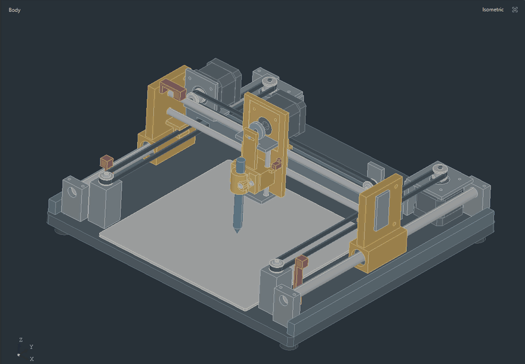
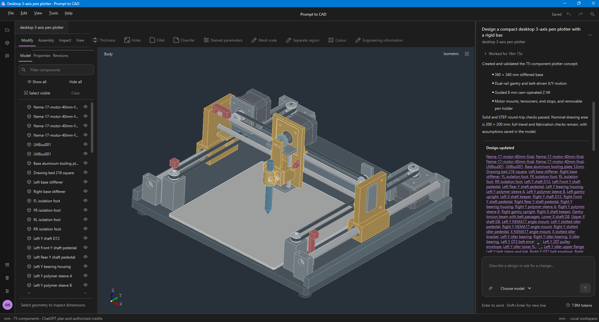

<p align="center">
  
</p>

<h1 align="center">Prompt to CAD</h1>

<p align="center">
  <strong>Describe an idea. Build an assembly. Refine it in conversation.</strong><br />
  A native Windows workspace for AI-assisted CAD, powered by Qt, OpenCascade and CadQuery.
</p>

<p align="center">
  <a href="#current-status"></a>
  <a href="docs/setup.md"></a>
  <a href="docs/setup.md"></a>
  <a href="LICENSE"></a>
</p>

<p align="center">
  <a href="#in-action">Demo</a> ·
  <a href="#what-you-can-do">Features</a> ·
  <a href="#build-and-run">Get started</a> ·
  <a href="#documentation">Documentation</a>
</p>

## In action



<p align="center">
  <strong>Desktop 3-axis pen plotter</strong> · 75-component concept · Editable CAD assembly<br />
  <sub>Viewport recording supplied by the author. <a href="docs/demo-media.md">Media details</a></sub>
</p>

A rigid base, dual-rail gantry, belt-driven X/Y layout and guided pen lift—all in one assembly, with motors, bearings, mounts, tensioners and a removable pen holder. It is a CAD concept; travel, fabrication and physical performance still need engineering checks.

<details>
<summary><strong>See the full workspace</strong> — model tree, viewport and conversation</summary>



</details>

## What you can do

| Feature | In the workspace |
| --- | --- |
| **Create through conversation** | Describe parts and assemblies, then refine supported geometry with holes, offsets, fillets, chamfers, named parameters and controlled CadQuery scripts. |
| **Work with individual components** | Select, inspect, measure, reposition, hide and color components in the native 3D viewport. |
| **Use standard parts** | Add cq_warehouse fasteners, bearings, sprockets, chains and threads through chat, retaining their generator parameters. |
| **Keep designs editable** | Save local projects and conversations, revisit accepted revisions, undo/redo changes and make independent copies with Save As. |
| **Add context** | Keep dimensions, labels and design notes with the model. Attach reference images when the selected AI model supports them. |
| **Exchange geometry** | Import STEP/STP, editable JSON recipes and GLB/STL/OBJ/PLY meshes. Export solids as STEP/STL and visual geometry as GLB/STL. |

### From brief to revision

1. **Describe** the design, dimensions and important constraints. For example:

   > Design a compact desktop 3-axis pen plotter with a rigid base, a 200 × 200 mm drawing area, a dual-rail gantry, belt-driven X/Y motion and a removable pen holder. Keep the parts as separate components.

2. **Inspect** the result in 3D. Select a component and check its geometry and measurements.
3. **Refine** the design through follow-up requests or supported direct tools.
4. **Save and export** the accepted revision for your next CAD workflow.

The brief above is a suggested starting point, not a guaranteed reproduction of the showcased model. AI results depend on the request, model and supported operations.

## Build and run

**Windows 10/11 x64 · Build from source · No prebuilt installer**

Install these prerequisites first:

| Prerequisite | What you need |
| --- | --- |
| Git | Available on `PATH` for cloning and dependency installation. |
| Python | CPython 3.11 x64, including the `py` launcher. |
| C++ toolchain | Visual Studio 2022 Build Tools with **Desktop development with C++**, x64/x86 v143 tools and a Windows SDK. |
| Graphics | An OpenGL-capable graphics driver. |

Then run in PowerShell:

```powershell
git clone https://github.com/faheem-shah-umer/Prompt-to-CAD.git
cd Prompt-to-CAD
py -3.11 -m venv .venv
.venv\Scripts\python.exe -m pip install -r requirements-dev.txt
.venv\Scripts\python.exe -m tools.setup_windows --download-sdk
.venv\Scripts\python.exe -m tools.build_native
.\Run-PromptToCAD.cmd
```

Setup downloads pinned **Qt 6.9.0** and **OpenCascade 7.8.1** SDKs; Anaconda is not required. The build produces `build\bin\PromptToCAD.exe`. See the [setup guide](docs/setup.md) for exact dependencies and troubleshooting.

After the first build, double-click `Run-PromptToCAD.cmd` or run it again to launch. The launcher also works from another directory. Rebuild explicitly after changing C++ source; launching does not install dependencies or compile the app.

**Using AI:** Choose Codex or Claude on first launch (or later in Settings → AI connection). Codex needs a Codex executable with App Server support and your own eligible ChatGPT plan or OpenAI API key. Claude needs Claude Code installed, then either your own Claude Code sign-in (for example a Claude Pro/Max plan) or your own Anthropic API key; see [Claude integration](docs/claude-integration.md). No credentials or model weights are included. Viewing, import/export, measurement and supported direct tools work without AI.

## Documentation

| Guide | Find out more |
| --- | --- |
| [Setup & troubleshooting](docs/setup.md) | Requirements, source builds, launching and common fixes. |
| [Architecture](docs/architecture.md) | Native UI, Python backend, AI integration and geometry workers. |
| [CAD capabilities](docs/agentic-cad.md) | Supported operations, editable definitions, selection scope and implementation limits. |
| [Standard parts](docs/standard-parts.md) | cq_warehouse components and retained generator parameters. |
| [Privacy & local storage](docs/privacy.md) | Projects, credentials, provider requests and source boundaries. |
| [Turn logs](docs/turn-logs.md) | Local diagnostic records and their privacy limits. |
| [Agent skills](docs/agent-skills.md) | Bundled workflows and the current external-agent connection boundary. |

<details>
<summary><strong>Development checks and local files</strong></summary>

Run checks deliberately from the repository root:

```powershell
.venv\Scripts\python.exe -m tools.check_privacy
.venv\Scripts\python.exe -m tools.check_links
.venv\Scripts\python.exe -m tools.validate
```

Checks use synthetic data rather than live provider inference. The manual **Windows source check** workflow installs dependencies, builds and tests on a fresh Windows x64 runner, including a native viewport smoke check through the portable launcher.

Keep managed development output in the ignored repository folders: `.venv/`, `build/`, `.sdk/`, `.local/`, `tmp/` and `artifacts/`. The source launcher uses `build\bin\PromptToCAD.exe`; the existing personal VBS/desktop shortcut separately preserves `.local/desktop-build/` when present. Keep projects, chats, credentials and environments out of Git.

</details>

## Current status

Prompt to CAD is a personally maintained **early preview**. Use or adapt the source under MIT; there is currently no contributor program or prebuilt application distribution.

Imported files do not acquire their original feature history. Full sketch constraints, simulation, full GD&T and arbitrary proprietary CAD formats are not implemented. Geometry checks do not establish strength, tolerances or manufacturability; review generated designs before engineering use.

Projects and conversations are stored locally. AI requests send submitted context to the configured provider; see [privacy](docs/privacy.md). Existing Git history still needs privacy review before any future public visibility change.

Application source and original branding/icons use the [MIT license](LICENSE). Dependencies retain their own licenses; see [third-party notices](THIRD_PARTY_NOTICES.md).
