Editable features, assemblies and revisions
==========================================

Prompt to CAD is a feature-based CAD prototype with a native desktop window, React/TypeScript interface and configurable LLM inference. The design is stored as structured construction data; STEP and STL are derived exports.

Using the workspace
-------------------

1. Reopen **Prompt to CAD.lnk** or **Prompt to CAD.vbs** to load the updated build.
2. Describe a part or multiple connected components in **Explain Our Idea**, then choose **Create**.
3. Click a component in the viewport or the **Components** tree. Its permanent ID, parameters, measured extents and feature history appear in the inspector.
4. Describe a change in **Explain Your Change** and choose **Apply change**, or press **Ctrl+Enter**. The backend restricts the edit to the selected part.
5. Choose **Assembly** to add/remove parts, change other components or update relationships.
6. Use **Undo / Redo** to restore accepted revisions and **Open** to continue saved projects.
7. Export **STEP**, **STL**, **Editable project** or **Verification**.

Dimensions remain available for inspection; there is no manual dimension-entry form. If you omit sizes, the planner may create a concept with explicit assumptions. Review the geometry and assumptions against your intended design.

The parts tree also hides/shows individual components. Visibility and camera position are viewing controls, rather than design revisions. Isometric, top, front, Fit all and Fit part operate on the separate preview meshes.

Architecture
------------

```mermaid
flowchart LR
    A[Idea or selected-part change] --> Q[FastAPI background job]
    Q --> B[Configured LLM: assembly brief or typed edit]
    B --> C[Pydantic schema]
    C --> R[Build small component batches]
    R --> D[Apply typed edits]
    D --> E[Resolve parameters and dependencies]
    E --> F[Replay CadQuery feature histories]
    F --> G[Check solids and assembly]
    G -->|Rejected: bounded feedback| B
    G --> H[Export STEP and re-import]
    H --> I[Commit accepted revision]
    I --> J[Separate selectable preview meshes]
```



For creation, the LLM first returns an `AssemblyPlan`: component IDs, names, colours, parameters, placements, requirements and dependencies. It then supplies local feature recipes for at most three components at a time. The app attaches the planned metadata and checks actual geometry before continuing. An edit returns typed changes. Rejected JSON, geometry or assembly checks produce specific feedback for bounded repair by the same configured model. Both paths use the deterministic modeller. The application does not execute model-generated Python. See [Generation pipeline](generation-pipeline.md) for the detailed flow and reference-project comparison.

[Script guide](script-guide.md) lists file roles. The project modules are:

| Module | Responsibility |
| --- | --- |
| `design_schema.py` | Versioned construction format, features, components, relationships and edit operations. |
| `assembly_schema.py` | Assembly briefs, component recipes and dependency-graph validation. |
| `design_planner.py` | Staged generation, selected-part context, schema/geometry feedback and bounded repairs. |
| `design_jobs.py` | Background worker, progress snapshots, revision checks and local generation diagnostics. |
| `parameters.py` | Bounded arithmetic, cross-component references, dependency resolution and cycle rejection. |
| `modelling.py` | Actual CadQuery construction, per-feature checks and assembly verification. |
| `design_edits.py` | Applies targeted changes and protects IDs and selection scope. |
| `projects.py` | Exports, STEP checks, immutable revision files, accepted cursor and undo/redo. |
| `project_lock.py` | OS-level write lock shared by independently launched desktop windows. |
| `project_api.py` | FastAPI project routes and HTTP errors. |

The original plate endpoints remain available for compatibility and API exercises. The desktop interface submits design jobs and polls their progress; the project API still provides opening, deterministic construction, revisions and exports.

Editable construction format
----------------------------

Each project has a schema version, name, units, optional shared parameters, components, relationships and explicitly permitted intersection pairs. Each component has a permanent ID, name, colour, parameter definitions, an ordered feature list and a placement.

A minimal example:

```json
{
  "schema_version": 1,
  "name": "Turned sleeve",
  "units": "mm",
  "parameters": {},
  "components": [{
    "id": "sleeve",
    "name": "Sleeve",
    "parameters": { "outer_radius": 12, "inner_radius": 8, "height": 30 },
    "features": [
      { "id": "blank", "type": "cylinder", "radius": "outer_radius", "height": "height", "operation": "new" },
      { "id": "bore", "type": "hole", "radius": "inner_radius", "centres": [[0, 0]], "axis": "Z", "depth": null },
      { "id": "edge_round", "type": "fillet", "size": 0.5, "edges": "%Circle" }
    ],
    "expected_size": ["outer_radius * 2", "outer_radius * 2", "height"]
  }],
  "relationships": [],
  "allowed_intersections": []
}
```

Paste it into `POST /api/projects/from-spec` in FastAPI's interactive documentation, or save it as a `.cad.json` file and open it through the application. Defaults fill in colour and zero placements.

Feature values can be numbers or short arithmetic expressions. Bare names resolve within the component, then shared parameters. `base.thickness / 2 + spindle.height` references other parts; `shared.clearance` references a shared value. The resolver supports arithmetic, bounded powers, `pi`, `sin/cos/tan`, `sqrt`, `abs`, `min` and `max`. It rejects executable expressions, unknown names, non-finite values and circular dependencies.

Parameters should actually drive geometry. Creation reports unlinked parameters. An edit cannot save a changed parameter that is not used by a feature, placement or dependent expression: update the corresponding feature or add the missing reference.

Feature tools
-------------

| Type | Geometry and conventions |
| --- | --- |
| `box` | XYZ sizes; centred by default, or starts at the origin with `centered=false`. |
| `cylinder`, `cone` | Along +Z, from local z=0 to height. Cone supports a zero end radius. |
| `sphere` | Full sphere centred on its local origin. |
| `sketch` | One closed circle, rectangle, ellipse, polygon or periodic spline on XY/XZ/YZ. Uses its own origin and centre. Unused profile fields are rejected. |
| `extrude` | Earlier sketch and signed distance along its plane normal; optional symmetric extrusion. |
| `revolve` | Earlier sketch, explicit local axis and angle up to 360 degrees. |
| `loft` | Two to twelve earlier section sketches or parameterised inline stations in a named plane; smooth or ruled. |
| `sweep` | Earlier profile and a 3D polyline or spline path; profile orientation must fit the path. |
| `hole` | Explicit radius and list of centres. A null depth drills through the existing body; a positive depth drills inward from its positive bounding face. Axis Z uses XY centres; X uses YZ; Y uses XZ. |
| `fillet`, `chamfer` | Positive size and an edge selector such as `|Z`, `>Z` or `%Circle`. |
| `linear_pattern`, `circular_pattern` | Repeat an earlier feature's tool. Count includes its seed, which was already applied. Hole/cut patterns also use `operation=cut`. |
| `mirror` | Mirror an earlier tool across an explicit plane, then apply it. |
| `boolean` | Add, cut or intersect another component's local solid, with an explicit feature placement. Dependency cycles are rejected. |
| `thread` | Minor-diameter core plus a real swept triangular helical ridge; `internal=true` cuts that tool into an existing body. Supports handedness and pitch. |

Solid tools support `new`, `add`, `cut` and `intersect`. A component must finish as one connected solid; separate bodies belong in separate components. A cut that removes no material is rejected. Drilling verifies each hole intersects material, and rejects overlapping hole centres. Features must reference earlier sketches/tools in the same component; cross-part boolean dependencies are resolved before use.

Rotations are XYZ degrees, applied about the local origin in that order, followed by translation. Component placement is applied after its feature history. A component may also have an `attachment`: parent ID, world axis, side, two offset expressions and gap. The builder aligns its measured bounding face with the parent's opposite bounding face and derives the final translation after rebuilding. Offset axes follow XYZ order with the attachment axis omitted. This handles top/rear rests and automatically follows parent size edits; actual contact and intersection checks still reject unsuitable curved or rotated interfaces. It is not a general face-mate solver. Per-component STL vertices already contain world placement, so the frontend keeps their shared coordinates instead of centring each mesh separately.

New operations can be added by defining a Pydantic feature type, implementing its CadQuery construction, adding validation and tests, and updating the planner contract. This is the extension point for richer sketches, standardised gears/fasteners and additional freeform operations. Adding a named template is optional; the main engine remains compositional.

Assemblies and selection
------------------------

Assemblies preserve separate components and named STEP bodies. `coaxial` relationships check transformed axis direction and line separation. `contact` relationships check actual minimum BREP distance. `distance` relationships check the Euclidean distance between two transformed local anchors against a parameterised target, such as adjacent button-centre spacing. Every pair of components is checked for overlapping volume; unexpected intersections reject the revision. An intentional intersection must be explicitly declared and appears as a warning. Assembly feedback reports all failed relationships and intersections together, with measured world bounds for failed relationships.

Placements use parameter expressions. They are **verified**, rather than inferred by a full degrees-of-freedom solver. This first assembly layer has no motion simulation, joint limits or face-mate solver.

Three.js renders one mesh per permanent component ID. Raycasting uses those IDs to identify a clicked part. Selecting it does not rebuild CAD or call the configured LLM; it changes the inspector and edit scope. Preview highlighting never changes the underlying STEP solid.

Selected edits and revisions
----------------------------

The edit request contains the user instruction, selected component ID and base revision ID. The configured LLM receives that part's parameters, placement and complete feature history, plus shared parameters, other part summaries and relationships. Assembly mode supplies the full design.

Supported changes are `set_parameters`, `replace_feature`, `add_feature`, `remove_feature`, `set_placement`, `add_component`, `remove_component`, `set_relationship` and `remove_relationship`. A replacement keeps the existing feature ID. Selected mode prohibits changes to shared parameters, other part definitions and assembly topology.

Dependencies can still update another part's resulting position or shape. For example, changing only `spindle.height` from 32 to 48 moves a grip whose placement is `base.thickness / 2 + spindle.height`. The grip definition and its IDs remain unchanged.

Before committing, the backend rebuilds all components, checks geometry and relationships, exports and re-imports STEP, then atomically writes the accepted revision cursor. Invalid geometry, a provider error, quota exhaustion or an invalid plan leaves the old cursor untouched. Optimistic revision checks and an OS file lock prevent stale or simultaneous app windows from overwriting an accepted design.

Undo/Redo move the saved cursor without an LLM request or geometry rebuild. A new edit after Undo starts another forward branch. Earlier branch files are retained, while Redo follows the active branch.

Project files
-------------

```text
projects/<project-id>/
  project.json                    # active revision IDs and cursor
  .revision.lock                  # OS lock file
  revisions/<revision-id>/
    revision.json                 # design, measurements and component manifest
    summary.json                  # revision timeline entry
    design.cad.json               # editable current construction specification
    verification.json
    assembly.step                 # separate named component solids
    assembly.stl                  # combined preview/mesh export
    components/<part-id>.stl       # separate selectable world-space mesh
```

**Open** restores the local project's full active revision timeline. An exported `.cad.json` contains the current parameters and feature histories; reopening it creates a new project starting at revision 1. It does not carry the entire previous revision timeline. STEP import is not implemented.

API exercises
-------------

| Route | Purpose |
| --- | --- |
| `GET /api/projects` | Saved project summaries. |
| `POST /api/design-jobs` | Returns 202 and a job ID for staged creation or a selected/assembly edit. |
| `GET /api/design-jobs/{id}` | Job status, stage, part counts, request budget, elapsed time and final result/error. |
| `GET /api/design-jobs/{id}/diagnostics` | Local JSON containing the request, candidate responses and validation failures. |
| `POST /api/projects` | Synchronous staged creation for API exercises; returns plan, project or questions and inference metadata. |
| `POST /api/projects/from-spec` | Deterministic construction or editable JSON reopening, without inference. |
| `GET /api/projects/{id}` | Current revision, design, measurements, part previews and history. |
| `POST /api/projects/{id}/edits` | Selected or assembly edit through the configured LLM. |
| `POST /api/projects/{id}/changes` | Apply an explicit typed change plan without the configured LLM. The JSON body contains `request` and `plan`. |
| `POST /api/projects/{id}/undo`, `redo` | Move the accepted revision cursor. |
| `GET /api/projects/{id}/revisions/{revision}/files/{kind}` | STEP, STL, report or editable project JSON. |
| `GET /api/projects/{id}/revisions/{revision}/components/{component}.stl` | Separate part preview. |

For selected editing through the synchronous `POST /api/projects/{id}/edits` route:

```json
{
  "prompt": "Make this spindle 48 mm tall and keep its diameter unchanged.",
  "selected_component_id": "spindle",
  "base_revision_id": "<the current revision UUID>"
}
```

The synchronous backend routes return 422 for invalid plans/geometry, 409 for revision conflicts, 429 for LLM quota errors, 504 for inference timeout and 503 for missing configuration. A submitted job exposes a later failure in its status response. Each model request permits 8192 output tokens with a configurable timeout (90 seconds by default). Invalid output can receive up to three attempts per stage, within a 24-request action budget. The planner stops starting requests after ten minutes; an already running request may finish after that deadline. Quota, authentication, network and timeout failures are not retried, and there is no model/provider fallback. A creation prompt can contain up to 16,000 characters; edits retain an 8,000-character limit.

The job edit body also includes `project_id`; creation omits both IDs. Attachment surface distance is checked automatically, independently of declared contact relationships.

One in-process generation worker runs at a time. Job progress is not resumed after backend shutdown, although diagnostic files persist in `generation-jobs/`. The accepted revision is checked again at commit, so an intervening edit cannot be overwritten. Keep the application open until the job finishes.

Verification and limits
-----------------------

Run the backend suite using the instructions in the [README](../README.md). Tests use real CadQuery construction and mocked inference. They cover modelling operations, drilling, external/internal threads, dependencies, STEP exchange, selected-edit protection, invalid geometry, persistence, undo/redo, stale revisions and cross-window locks.

STEP comparison uses explicit numerical volume integration, 0.01 mm bounds tolerance, and 0.01 mm³ absolute or 1e-5 relative volume tolerance. Passing these checks does not prove the natural-language description was interpreted correctly.

The practical limits are 32 components, 256 total features, 96 features per part, 64 linear/128 circular copies, 12 loft sections and 48 turns per thread. Feature sizes are bounded at 2000 mm; local part extents at 10,000 mm; placements at ±10,000 mm. These caps keep the first CPU worker manageable. Loft/sweep/fillet feasibility still depends on the geometry.

This foundation does not guarantee arbitrary CAD requests. It has no general mechanical constraint solver, face/edge picking, imported feature recovery, sculpted surface modeller, standard gear generator, strength analysis or manufacturing validation. Its triangular helical threads are geometric demonstrations, not certified ISO fasteners. **Verified** means the implemented solid, assembly and STEP checks pass; review the model against your intended dimensions and function.

The next milestone should evaluate varied prompts against intended geometry, improve dimensional assertions and measure success rates for the configured model. STEP import, richer sketch constraints, durable face references and full assembly solving are separate extensions.

References
----------

The engine uses [CadQuery's modelling API](https://cadquery.readthedocs.io/en/latest/classreference.html) and [named assembly STEP export](https://cadquery.readthedocs.io/en/latest/importexport.html). HTTP validation is built on [FastAPI request bodies](https://fastapi.tiangolo.com/tutorial/body/). Local Python signatures were checked against the installed CadQuery 2.7.0.
